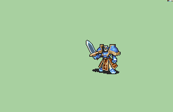
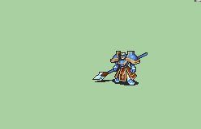
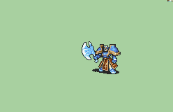
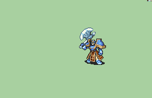
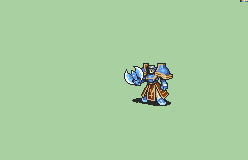
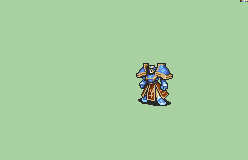

# [\[General-Reskin\] Female General \[F\] by RiriK](https://github.com/Klokinator/FE-Repo/tree/main/Battle%20Animations/Infantry%20-%20Knights,%20Generals,%20Armors/%5BGeneral-Reskin%5D%20Female%20General%20%5BF%5D%20by%20RiriK)  

| <b>Knife</b>  | <b>Sword (Main Range Back Crit)</b>  | <b>Sword (Main Range Front Crit)</b>  |
| :---: | :---: | :---: |
| <b>Sword (Variant Chain Range Back Crit)</b>  | <b>Sword (Variant Chain Range Front Crit)</b>  | <b>Lance</b>  |
| <b>Lance (Chainless)</b>  | <b>Lance (Main Range Back Crit)</b>  | <b>Lance (Main Range Front Crit)</b>  |
| <b>Lance (Variant Chain Range Back Crit)</b>  | <b>Lance (Variant Chain Range Front Crit)</b>  | <b>Axe</b>  |
| <b>Axe  (Main Range Front Crit)</b>  | <b>Axe (Main Range Back Crit)</b>  | <b>Axe (Variant Chain Range Back Crit)</b>  |
| <b>Axe (Variant Chain Range Front Crit)</b>  | <b>Handaxe</b>  | <b>Bow (Cannon)</b>  |
| <b>Unarmed</b>  |

## Credits

F2U/F2E

Female/Long haired General By RiriK/Rikki

Original General Sword Chain animation by Knabepicer

Credit to Redbean for certain parts

Credit to  Marlon&Louis Fire Hacks' patches that included the original map sprites for [Marshal], who I believe is by Nuramon, so also credits to him as well (Marshal (M) Zelgius Helmless Sword Map Sprite)

Credit to GabrielKnight for the original Bow (Cannon) General.

Knife ported by tatata.

Lance (Chainless, Main Range Back Crit, Main Range Front Crit) ported by tatata.

Lance (Variant Chain Range Back Crit, Variant Chain Range Front Crit) ported by tatata.

Axe (Main Range Front Crit, Main Range Back Crit) ported by tatata.

Axe (Variant Chain Range Back Crit, Variant Chain Range Front Crit) ported by tatata.

