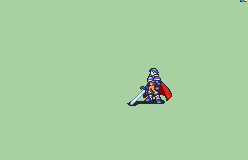
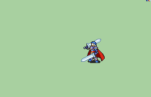
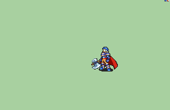
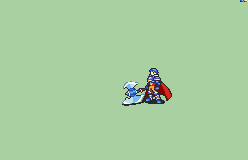
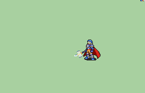

# [\[FE7 Hector-Base\] T1 Repal \[M\] by Nuramon](https://github.com/Klokinator/FE-Repo/tree/main/Battle%20Animations/Lords%20-%20Vanilla%20and%20Custom/%5BFE7%20Hector-Base%5D%20T1%20Repal%20%5BM%5D%20by%20Nuramon)  

| <b>Sword</b>  | <b>Sword (Alt Sword)</b>  | <b>Sword (Broadsword)</b>  |
| :---: | :---: | :---: |
| <b>Sword (T1 Orion motion Dual Blade)</b>  | <b>Axe</b>  | <b>Axe (Armads)</b>  |
| <b>Axe (Hammer)</b>  | <b>Axe (Punch Crit)</b>  | <b>Handaxe</b>  |
| <b>Handaxe (Alt Crit 1)</b>  | <b>Handaxe (Alt Crit 2)</b>  | <b>Magic</b>  |
| <b>Unarmed</b>  |

## Credits

F2U/F2E

Base animation by IS.

Still by George Reds.

Repalette by Nuramon.

Sword and Sword (Alt, Broadsword, T1 Orion Dual Blade) ported by tatata.

Axe (Armads), Axe (Hammer), Axe (Punch Crit), Handaxe (Alt Crit 1 and 2) ported by tatata.

Magic ported by tatata.

