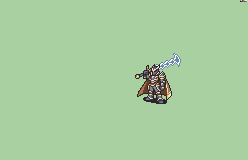
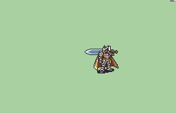
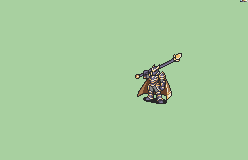
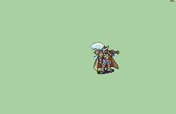
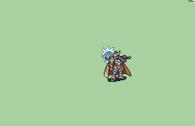
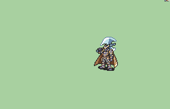
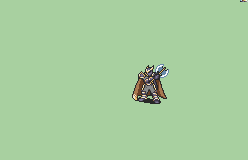
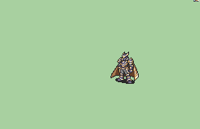

# [\[FE7 Hector-Variant\] T2 Legendary Harbinger \[U\]](https://github.com/Klokinator/FE-Repo/tree/main/Battle%20Animations/Lords%20-%20Vanilla%20and%20Custom/%5BFE7%20Hector-Variant%5D%20T2%20Legendary%20Harbinger%20%5BU%5D)  

| <b>Sword</b>  | <b>Sword (Durandal)</b>  | <b>Sword (Greatsword)</b>  |
| :---: | :---: | :---: |
| <b>Sword (Vanilla)</b>  | <b>Lance</b>  | <b>Axe</b>  |
| <b>Axe (Armads (Official Art - magic)</b>  | <b>Axe (Armads (Official Art))</b>  | <b>Axe (Armads (OG - magic)</b>  |
| <b>Axe (Armads (OG)</b>  | <b>Axe (magic)</b>  | <b>Axe (Replace default Axe)</b>  |
| <b>Axe (vanilla)</b>  | <b>Handaxe</b>  | <b>Unarmed</b>  |

## Credits

F2U/F2E

Animation by tatata.

Based off of [FE7 Hector-Reskin] T2 Legendary [M] by Apolo15

Harbinger design by Nuramon.

Axe by Seliost1.

