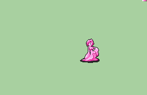

# [\[Monster-Custom\] \[F\] Slimegal by Stephano](https://github.com/Klokinator/FE-Repo/tree/main/Battle%20Animations/Monsters%20-%20Dragons%20and%20Special/%5BMonster-Custom%5D%20%5BF%5D%20Slimegal%20by%20Stephano)  

| <b>Monster</b>  | <b>Monster (Longer + Physics)</b>  | <b>Monster (Longer)</b>  |
| :---: | :---: | :---: |
| <b>Monster (No Transparency)</b>  | <b>Monster (Physics - No Transparency)</b>  | <b>Monster (Physics)</b>  |

## Credits

Character Design by Wayforward(TM).

Port by Stephano.

Note: The No Transparency versions are for a the 'devouring' effect to not be see-through.

